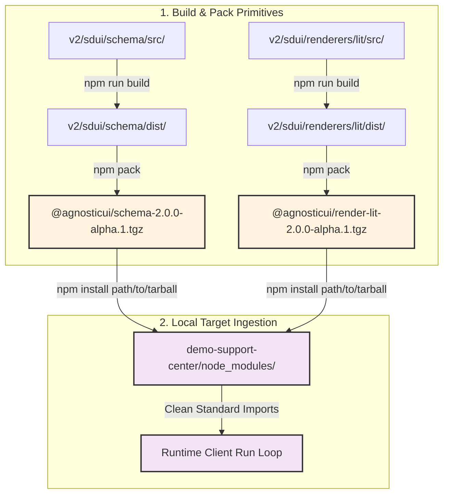

# AgnosticUI Support Center Workspace Ingestion Guide

This workspace serves as an End-to-End (E2E) verification platform and interactive reference simulator for Schema-Driven UI (SDUI) workflows.

---

## 1. Local Monorepo Tarball Lifecycle Architecture

Rather than relying on real-time compilation links or immediate relative file system traversals outside our project root, we implement a strict local ingestion pattern using `npm pack`. This pattern builds and bundles production archives (`.tgz`), forcing the application to "dogfood" the exact distribution packages that will eventually hit the public npm registry.



---

## 2. Step-by-Step Setup & Compilation Loop

Follow these steps sequentially inside your terminal window to build, package, and link your core libraries into the Support Center workspace.

### Step 2.1: Compile and Pack the Core SDUI Schema Registry
Start from your repository root directory and move into the schema folder:
```bash
cd v2/sdui/schema
npm run codegen -- --emit-schema-json
npm run check-codegen
npm run build
npm pack
```

### Step 2.2: Compile and Pack the Lit Custom Component Renderer
Return to the repository root directory before moving into the Lit renderer core folder:
```bash
cd ../../..
cd v2/sdui/renderers/lit
npm run build
npm pack
```

### Step 2.3: Install Packed Ingestion Archives into the Support Center
Return to the repository root directory once more before entering the Demo Support Center workspace root:
```bash
cd ../../..
cd v2/sdui/demo-support-center
npm install ../schema/agnosticui-schema-2.0.0-alpha.1.tgz ../renderers/lit/agnosticui-render-lit-2.0.0-alpha.1.tgz
```
* **Note:** Preserves existing package names and versions using precise, relative path references.

---

## 3. Local Runtime Execution Loops

The development sandbox operates as a decoupled dual-process architecture. Follow these instructions to launch both your live visual workspace interactive environment and your automated metrics assertion engine.

### 3.1 Browser-Based Payment Remediation Sandbox (Localhost:5173)
This loop boots up a local Hono streaming server back-to-back with a Vite development server to test the end-to-end full-duplex support flows.

1. **Terminal Tab 1 — Launch the Backend Hono Gateway Port:**
   ```bash
   cd v2/sdui/demo-support-center
   npm run server
   ```
   * *Telemetry Check:* The console will emit `[GATEWAY_START] 🚀 Gateway live at http://localhost:3000`.

2. **Terminal Tab 2 — Launch the Frontend Vite Sandbox:**
   ```bash
   cd v2/sdui/demo-support-center
   npm run dev
   ```
   * *Telemetry Check:* The terminal wraps the dev dependencies and reports `Local: http://localhost:5173/`.

3. **Verify the E2E Account Failure Loop:**
   * Open your browser window viewport at `http://localhost:5173/`.
   * Type this inquiry text string inside the minimalist **Simulator Controls** form and hit enter: `User usr_992 can't see invoices`.
   * The Hono backend tool evaluates `mockData.ts`, checks the node shapes via `nodeGuard.ts`, and streams the payment form onto your canvas via serverless proxying.
   * Input a test 16-digit payment card number inside the browser canvas element, click **SUBMIT REMEDIATION TRANSACTION**, and observe full-duplex execution logs running right inside the Chrome inspector terminal!

---

### 3.2 Automated Promptfoo Metric Evaluations (Ollama Runner)
To programmatically test prompt compliance matrices against your local open-weight **`qwen2.5-coder:1.5b`** model without using external cloud tokens or payment keys, execute the unified script runner:

1. Ensure your local background Ollama process is up and running (`ollama serve`).
2. Run the evaluation script directly from your terminal workspace root:
   ```bash
   cd v2/sdui/demo-support-center
   npm run promptfoo
   ```

* **Expected Output Metric Summary Logs:**
  ```text
  Evaluating [████████████████████████████████████████] 100% | 2/2
  [PASS] Verify past_due account anomalies for usr_992...
  [PASS] Verify active green account lookups bypass...
  ✓ 2 passed (100% prompt compliance metrics achieved)
  ```

---

## 4. Diagnostics & Troubleshooting Telemetry

### 4.1 Checking Active Linking States
To confirm that your demo workspace is reading the authentic local package contents instead of a remote proxy registry layer, run the package info inquiry tool:
```bash
npm list @agnosticui/schema @agnosticui/render-lit
```

### 4.2 Handling Stale Archive State Caches
If you alter component code inside `v2/sdui/renderers/lit/src/` or update types inside `v2/sdui/schema/src/`, you **must** rebuild the pack archives. To fully refresh the node execution cache inside the demo application, run a clean chapters purge sequence:
```bash
# Inside v2/sdui/demo-support-center
rm -rf node_modules package-lock.json
npm install
```
This forces the package manager engine to unpack the freshly modified `.tgz` contents directly onto your active execution footprint.
