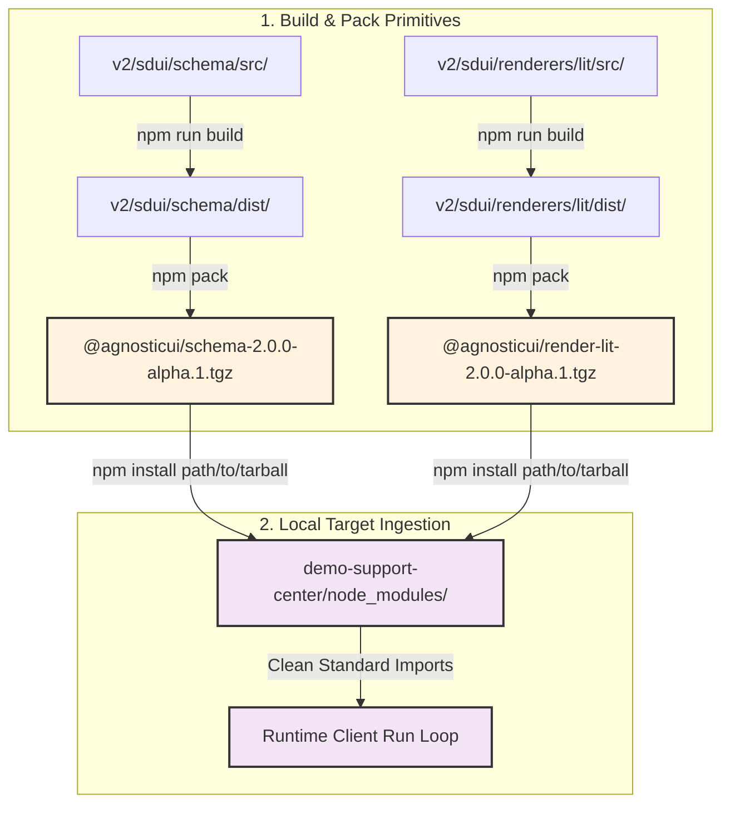

# AgnosticUI Support Center Workspace Ingestion Guide

This workspace serves as an End-to-End (E2E) verification platform and interactive reference simulator for Schema-Driven UI (SDUI) workflows. To guarantee a production-grade integration layer, this demo bypasses arbitrary local path aliases and instead consumes local compiled package distributions generated directly from the monorepo core.

---

## 1. Local Monorepo Tarball Lifecycle Architecture

Rather than relying on real-time compilation links or immediate relative file system traversals outside our project root, we implement a strict local ingestion pattern using `npm pack`. This pattern builds and bundles production archives (`.tgz`), forcing the application to "dogfood" the exact distribution packages that will eventually hit the public npm registry.



---

## 2. Step-by-Step Setup & Compilation Loop

Follow these steps sequentially inside your terminal window to build, package, and link your core libraries into the Support Center workspace.

### Step 2.1: Compile and Pack the Core SDUI Schema Registry
Navigate into the foundational schema directory, build the TypeScript distribution targets, and produce the tarball archive:
```bash
cd v2/sdui/schema
npm run build
npm pack
```
* **Expected Output Artifact:** A compressed file named exactly `agnosticui-schema-2.0.0-alpha.1.tgz` will be written to the `v2/sdui/schema/` directory root.

### Step 2.2: Compile and Pack the Lit Custom Component Renderer
Navigate into the Lit renderer core directory, execute the local compiler suite, and compile the workspace layer:
```bash
cd v2/sdui/renderers/lit
npm run build
npm pack
```
* **Expected Output Artifact:** A compressed file named exactly `agnosticui-render-lit-2.0.0-alpha.1.tgz` will be written to the `v2/sdui/renderers/lit/` directory root.

### Step 2.3: Install Packed Ingestion Archives into the Support Center
Navigate back into the Demo Support Center workspace root and inject the precise tarball paths using the native package manager installation command:
```bash
cd v2/sdui/demo-support-center
npm install ../../schema/agnosticui-schema-2.0.0-alpha.1.tgz ../../renderers/lit/agnosticui-render-lit-2.0.0-alpha.1.tgz
```

---

## 3. Operational Code Implications & Consumption Mappings

Once linked, your dependencies are registered explicitly inside `v2/sdui/demo-support-center/package.json` pointing directly to local tarball paths:

```json
"dependencies": {
  "@agnosticui/schema": "file:../../schema/agnosticui-schema-2.0.0-alpha.1.tgz",
  "@agnosticui/render-lit": "file:../../renderers/lit/agnosticui-render-lit-2.0.0-alpha.1.tgz",
  "hono": "^4.13.16"
}
```

### 3.1 Seamless Import Semantics
Any file processing streaming JSON schema evaluations or running client-side hydration layouts inside this demo can now reference standard package pathways. 

For instance, your application code can import directly from the local node-modules container:
```typescript
// Verified standard library consumption within demo client loops
import { type AgNode } from '@agnosticui/schema';
import { AgDynamicRenderer } from '@agnosticui/render-lit';

const canvasElement = document.getElementById('sdui-canvas')!;
const renderer = new AgDynamicRenderer(canvasElement);
```

---

## 4. Diagnostics & Troubleshooting Telemetry

### 4.1 Checking Active Linking States
To confirm that your demo workspace is reading the authentic local package contents instead of a remote proxy registry layer, run the package info inquiry tool:
```bash
npm list @agnosticui/schema @agnosticui/render-lit
```
* **Successful Response Verification Terminal Mirror:**
  ```text
  demo-support-center@1.0.0 v2/sdui/demo-support-center
  ├── @agnosticui/render-lit@2.0.0-alpha.1 -> file:../../renderers/lit/agnosticui-render-lit-2.0.0-alpha.1.tgz
  └── @agnosticui/schema@2.0.0-alpha.1 -> file:../../schema/agnosticui-schema-2.0.0-alpha.1.tgz
  ```

### 4.2 Handling Stale Archive State Caches
If you alter component code inside `v2/sdui/renderers/lit/src/` or update types inside `v2/sdui/schema/src/`, you **must** rebuild the pack archives. To fully refresh the node execution cache inside the demo application, run a clean purge sequence:
```bash
# Inside v2/sdui/demo-support-center
rm -rf node_modules package-lock.json
npm install
```
This forces the package manager engine to unpack the freshly modified `.tgz` contents directly onto your active execution footprint.
