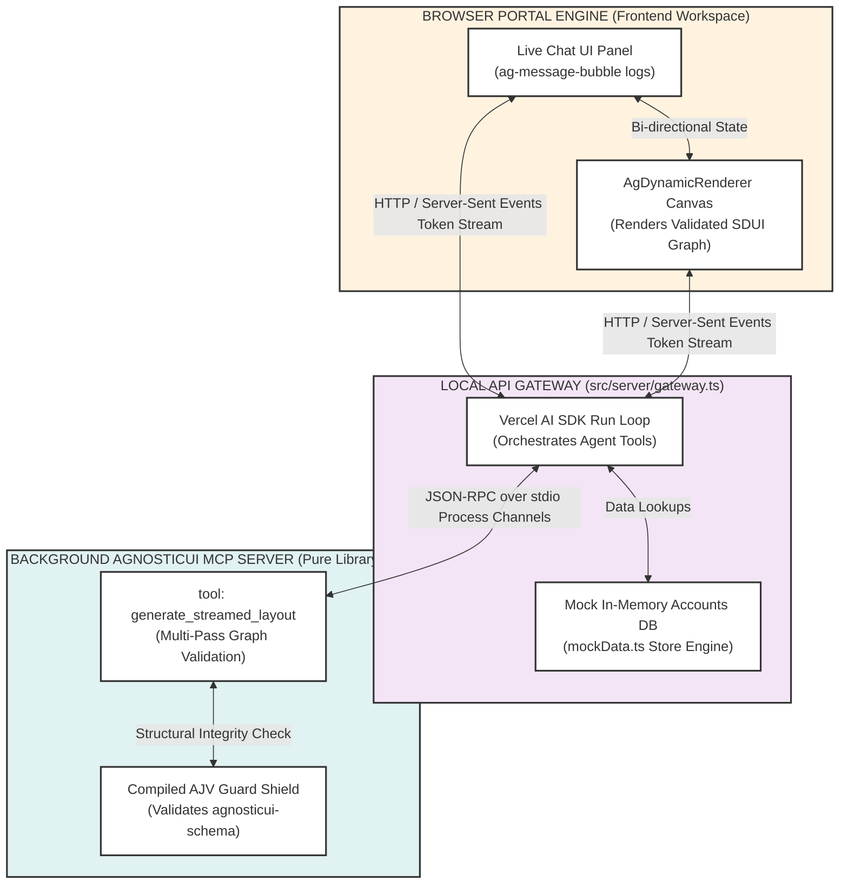
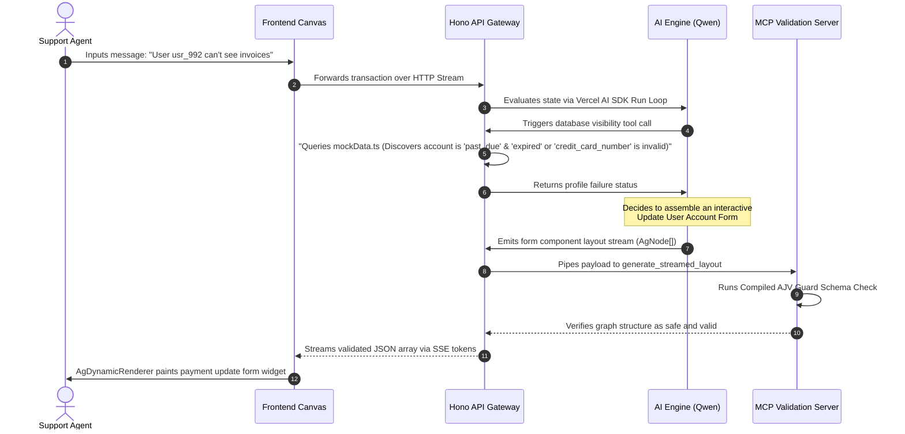

# PRODUCT REQUIREMENTS DOCUMENT (PRD)

**Document Version:** 1.0.0  
**Status:** Approved / Specification Phase  
**Location Target:** `v2/sdui/demo-support-center/docs/e2e-support-agent-prd.md`  

---

## 1. Executive Summary & Core Objective


### 1.1 Objective & Vision
The **AgnosticUI E2E Support Agent Demo** is a self-contained reference application housed within a dedicated directory at `v2/sdui/demo-support-center/`. This application demonstrates how a framework-agnostic component system can be driven dynamically by a local open-weight AI model (`qwen2.5-coder`) using an interactive **Schema-Driven UI (SDUI)** architecture.

The application exposes a multi-turn support workflow. An AI agent processes natural language developer or customer service inquiries, calls local functions to inspect account data states, detects blockages (such as expired credit cards), and autonomously streams back **deterministically safe JSON layout graphs (`AgNode[]`)** verified on the fly by the local AgnosticUI Model Context Protocol (MCP) server.


### 1.2 System Topology Diagram
```text
┌────────────────────────────────────────────────────────────────────────┐
│ BROWSER PORTAL ENGINE (v2/sdui/demo-support-center/ Frontend Workspace)│
│                                                                        │
│ ┌──────────────────────────┐          ┌──────────────────────────────┐ │
│ │ Live Chat UI Panel       │          │ AgDynamicRenderer Canvas     │ │
│ │ (ag-message-bubble logs) │◄────────►│ (Renders Validated SDUI Graph)│ │
│ └───────────▲──────────────┘          └──────────────▲───────────────┘ │
└─────────────┼────────────────────────────────────────┼─────────────────┘
              │ (HTTP / Server-Sent Events Token Stream)
┌─────────────▼────────────────────────────────────────┴─────────────────┐
│ LOCAL API GATEWAY (v2/sdui/demo-support-center/src/server/gateway.ts)  │
│                                                                        │
│ ┌──────────────────────────┐          ┌──────────────────────────────┐ │
│ │ Vercel AI SDK Run Loop   │◄────────►│ Mock In-Memory Accounts DB   │ │
│ │ (Orchestrates Agent Tools)│          │ (mockData.ts Store Engine)   │ │
│ └───────────▲──────────────┘          └──────────────────────────────┘ │
└─────────────┼──────────────────────────────────────────────────────────┘
              │ (JSON-RPC over stdio Process Channels)
┌─────────────▼──────────────────────────────────────────────────────────┐
│ BACKGROUND AGNOSTICUI MCP SERVER (v2/mcp-server/ Pure Library Core)   │
│                                                                        │
│ ┌──────────────────────────────┐      ┌──────────────────────────────┐ │
│ │ tool: generate_streamed_layout│◄────►│ Compiled AJV Guard Shield    │ │
│ │ (Multi-Pass Graph Validation)│      │ (Validates agnosticui-schema)│ │
│ └──────────────────────────────┘      └──────────────────────────────┘ │
└────────────────────────────────────────────────────────────────────────┘
```

---

## 2. Target User Interaction & Account Failure Loop



1. **Context Initialization:** A customer support representative opens the custom support workspace to investigate a billing issue for user account **`usr_992`**.
2. **Natural Language Request:** The representative inputs a message: `"User usr_992 states they are receiving an error when trying to view their enterprise invoice data sheet."`
3. **Agentic Tool Evaluation:** The local Hono gateway forwards the transaction to the Vercel AI SDK loop. The model determines that it needs explicit database visibility and executes a tool call to query account parameters.
4. **Data Condition Discovery:** The data function queries the mock database file and flags that the user's account state is currently `past_due` because their primary payment method is `expired`.
5. **Structural Graph Emission:** The AI model skips lengthy text explanations. Instead, it generates a precise JSON layout graph (`AgNode[]`) outlining an interactive `AgCard` containing a payment card `AgInput` field and an update trigger `AgButton` linked back to a secure action handler.
6. **Background MCP Verification:** The raw streamed node array is intercepted by the server gateway and piped through the background MCP server's **`generate_streamed_layout`** validation step. The internal AJV engine validates the elements against `agnosticui-schema.json` to ensure valid tags, parameters, and layout trees.
7. **Frontend Canvas Streaming:** The validated JSON structures stream into the client browser layout, continuously appending to the active nodes array. The stateless `AgDynamicRenderer` builds out the payment update form widget incrementally in real-time without causing page reloads.

---

## 3. Data Tier Layouts & Schemas

### 3.1 Isolated Mock Database (`v2/sdui/demo-support-center/src/db/mockData.ts`)
To shield existing directories and core library manifests from contamination, all data structures are strictly isolated inside the new package boundary.

```typescript
export interface UserAccount {
  id: string;
  name: string;
  email: string;
  plan: 'free' | 'pro' | 'enterprise';
  accountStatus: 'active' | 'suspended' | 'past_due';
}

export interface BillingProfile {
  userId: string;
  cardBrand: string;
  cardLast4: string;
  expiryStatus: 'valid' | 'expired';
  outstandingBalance: number;
}

export const mockUsersAccounts: Record<string, UserAccount> = {
  "usr_992": {
    id: "usr_992",
    name: "Sam Troublesome",
    email: "sam@error-logs.com",
    plan: "enterprise",
    accountStatus: "past_due"
  }
};

export const mockBillingProfiles: Record<string, BillingProfile> = {
  "usr_992": {
    userId: "usr_992",
    cardBrand: "MasterCard",
    cardLast4: "9981",
    expiryStatus: "expired",
    outstandingBalance: 150.00
  }
};
```

---

## 4. Technical Constraints & Security Infrastructure

* **Strict Code Isolation:** The workspace codebase must remain fully self-contained inside `v2/sdui/demo-support-center/` and can never alter or mutate code records in sibling folders.
* **Malformed Component Dropping:** Any streaming node layout payload failing the MCP validation check is discarded immediately at the gateway layer before hitting the client browser canvas.
* **Fail-Fast Stream Parsing (Incremental Validation):** The gateway layer does not wait for the full LLM response to complete before validating. It utilizes a progressive JSON stream parser to isolate and validate complete, individual component node objects (`AgNode`) within the streaming array in real-time. If an early component block violates the schema vocabulary or structure, the stream terminates instantly, preventing resource waste and ensuring corrupted code never touches the client canvas.
* **Action Token Sanitization:** Incoming interactive events (e.g., `on_click: 'SUBMIT_BILLING_DELTA'`) are parsed strictly as validation mapping keys against an immutable local JavaScript lookup dictionary. This forms an absolute XSS security boundary inside the Light DOM environment.
* **Strict Vocabulary Conformity (Anti-Hallucination Guard):** The background validation layer rejects data graphs containing perfectly valid standard HTML tags (e.g., `<button>`, `<div>`) or external UI frameworks that do not explicitly target an authorized AgnosticUI component schema variant definition (e.g., `AgButton`, `AgCard`). Code that is structurally sound but contextually unaligned with the AgnosticUI rendering engine is treated as invalid and dropped instantly.
* **Decoupled Quality Evaluation (Non-Deterministic Boundary):** The background MCP server explicitly isolates structural safety from response quality. The validation guard enforces layout syntax, schema conformity, and security rules; it does *not* evaluate or enforce "how good," contextually accurate, or visually optimal the dynamic UI response is. UI aesthetic synthesis and utility remain entirely non-deterministic, moving with the inherent intelligence and capabilities of the downstream LLM engine.

---

## 5. Automation Testing Metric Profiles (Promptfoo Configurations)

To systematically benchmark model outputs against our architectural constraints, an automated evaluation test harness is integrated directly into the workspace root.

* **Configuration Vector Path:** `v2/sdui/demo-support-center/promptfoo.yaml`
* **Core Philosophy:** Because LLM outputs are inherently non-deterministic, these tests do not grade visual style or wording quality. Instead, they treat the LLM as a data synthesizer, programmatically verifying that its output complies with structural schemas, contains zero forbidden native elements, and terminates correctly during failure loops.

### 5.1 Programmatic Assertions Matrix
Every test scenario runs through an automated assertion pipeline checking four specific dimensions:

```yaml
# v2/sdui/demo-support-center/promptfoo.yaml
description: 'AgnosticUI SDUI Support Agent Evaluation Suite'

providers:
  - id: 'ollama:chat:qwen2.5-coder'
    config:
      temperature: 0.0
      seed: 42

tests:
  - description: 'Account past_due billing blockage simulation'
    vars:
      user_id: 'usr_992'
      incoming_ticket: 'User usr_992 states they are receiving an error when trying to view their enterprise invoice data sheet.'
      context_state: 'status: past_due, primary_card: expired, balance: \$150.00, brand: MasterCard, last4: 9981'
    
    assert:
      # 1. Structural JSON Integrity
      - type: is-json
        description: 'Verify the output array can be natively parsed as valid JSON without throwing syntax errors.'

      # 2. Strict Vocabulary Conformity (Anti-Hallucination Guard)
      - type: javascript
        value: |
          // Ensure output contains only allowed AgnosticUI components and NO raw HTML/external components
          const allowedComponents = ['AgCard', 'AgInput', 'AgButton', 'AgMessageBubble', 'AgText'];
          try {
            const nodes = JSON.parse(output);
            if (!Array.isArray(nodes)) return false;
            return nodes.every(node => allowedComponents.includes(node.type || node.tag));
          } catch (e) {
            return false;
          }
        description: 'Assert that the LLM did not hallucinate raw HTML tags (<button>, <div>) or external design systems.'

      # 3. Functional Data Binding Context
      - type: contains
        value: '9981'
        description: 'Verify that the model accurately injected the contextual account breakdown variables into the UI graph.'

      # 4. Action Token Sanitization Alignment
      - type: javascript
        value: |
          // Ensure click actions align with the immutable local gateway lookup keys
          try {
            const nodes = JSON.parse(output);
            const stringified = JSON.stringify(nodes);
            // Must use the locked key token, not raw executable javascript strings
            return stringified.includes('SUBMIT_BILLING_DELTA') && !stringified.includes('javascript:');
          } catch (e) {
            return false;
          }
        description: 'Assert that interactive actions output safe token keys mapped to our internal action dictionary.'
```

### 5.2 Value Metrics for Engineering Evaluation
By checking this test harness into the repository, the project demonstrates enterprise-level engineering standards by exposing:
1. **Regression Testing for Prompts:** If someone tweaks the underlying system prompt to change the agent's tone, this suite guarantees they didn't accidentally break the strict JSON node formatting or cause the model to hallucinate native HTML.
2. **Deterministic Confidence Metrics:** It proves that a non-deterministic AI core can still be safely bound to a production-grade testing pipeline, achieving repeatable compliance scores before the application layer is deployed to edge runtimes.

---

## 6. Deployment & Infrastructure Typologies

```mermaid
flowchart TD
    subgraph LOCAL_TOPOLOGY["6.1 Local Development (Localhost)"]
        L_FE["Vite Frontend Sandbox\n(Port 5173)"] <-->|HTTP / SSE| L_GW["Hono Node.js Gateway\n(Port 3000)"]
        L_GW <-->|stdio JSON-RPC| L_MCP["Background MCP Daemon\n(dist/index.js Process)"]
        L_MCP <-->|Local API Pipes| L_LLM["Native Ollama Engine\n(qwen2.5-coder / LanceDB)"]
    end

    subgraph CLOUD_TOPOLOGY["6.2 Cloud Production (Cloudflare Edge Architecture)"]
        C_FE["Static Cloudflare Pages\n(Edge CDN Delivery)"] <-->|Turnstile Bot Shield| C_GW["Cloudflare Workers Gateway\n(Hono Edge Engine)"]
        C_GW <-->|Stateful Connection Broker| C_DO["Cloudflare Durable Objects\n(WebSocket Keep-Alive Instance)"]
        C_DO <-->|Persistent WebSocket Pipe| C_MCP["Persistent VPS Cluster\n(Node MCP Runtime Host)"]
        C_MCP <-->|Secure Cloud Routing| C_LLM["Hosted Cloud LLM API\n(DeepSeek / Scale Cloud)"]
    end

    %% High-Contrast Accessibility Styling
    classDef darkText fill:#ffffff,stroke:#333333,stroke-width:2px,color:#333333;
    class L_FE,L_GW,L_MCP,L_LLM,C_FE,C_GW,C_DO,C_MCP,C_LLM darkText;

    style LOCAL_TOPOLOGY fill:#f9f9f9,stroke:#333333,stroke-width:2px,color:#333333;
    style CLOUD_TOPOLOGY fill:#efebe9,stroke:#333333,stroke-width:2px,color:#333333;
```



To balance zero-cost local prototyping with enterprise resume highlights, the infrastructure targets a strict dual-topology blueprint.

### 6.1 Local Development (Localhost Architecture)
* **The Stack:** Hono Node.js Entry Server (`@hono/node-server`), Native Ollama Engine, and local standard I/O pipes (`stdio`).
* **Execution Boundary:** The API gateway runs as a standard Node process on `localhost:3000`. It spawns or maps directly to the compiled background `v2/mcp-server/dist/index.js` daemon over native OS command channels, querying the local `qwen2.5-coder` instance with no external web overhead.

### 6.2 Cloud Production (Target Cloudflare Edge Architecture)
* **The Stack:** Cloudflare Workers (Hono Gateway Edge), Cloudflare Durable Objects (Stateful WebSocket Router), Cloudflare Workers Turnstile (Bot Shield), and a persistent Node/VPS cluster (MCP Runtime Host).
* **Execution Boundary:** 
  * The frontend static pages are delivered globally via **Cloudflare Pages** at the edge. 
  * API endpoints are intercepted immediately by a serverless **Cloudflare Worker running Hono**. Turnstile injects non-intrusive CAPTCHA checks to mitigate resource exhaustion attacks against downstream infrastructure.
  * Because standard Cloudflare Worker edge runtimes are stateless and short-lived, they cannot maintain long-running WebSocket channels natively. In production environments, the Worker routes communication through a **Cloudflare Durable Object** instance. This stateful coordinator establishes and maintains an isolated, long-lived, high-stability WebSocket connection down to your background **MCP Server** hosted on a cloud VPS cluster, completely neutralizing serverless timeout limitations.

---

## Appendix A: Local vs. Cloud Architecture Symmetry Matrix

To maintain strict behavioral alignment between zero-cost local prototyping and highly available production tiers, the underlying execution logic remains perfectly uniform. The runtime simply swaps transport layers and engine boundaries using environment variables, while preserving the core system design patterns.

| Architectural Role | Localhost Prototyping (`6.1`) | Production Cloud Environment (`6.2`) | Cloudflare Cost Tier |
| :--- | :--- | :--- | :--- |
| **The User Interface Canvas** | `Vite Frontend` (Local Host on Port `5173`) | **Cloudflare Pages** (Globally Distributed Edge CDN Assets) | **$0.00 Free Tier** (Unlimited Bandwidth) |
| **The Intelligent Orchestrator** | `Hono Node Server` (Local Host on Port `3000`) | **Cloudflare Workers** (Serverless Hono Edge Pipeline) | **$0.00 Free Tier** (Up to 100k requests/day) |
| **The Stateful Connection Broker** | *Not Required* (Direct OS process mapping) | **Cloudflare Durable Objects** (Stateful Connection Coordinator) | **Low Cost** (Included in Workers Paid tier or micro-cents allocation) |
| **The Compliance Guard Shield** | `v2/mcp-server` (Interacted via OS Standard `stdio`) | **Persistent Server Instance** (Interacted via Durable Object WebSocket Pipe) | **Self-Hosted** (Or zero-tier cloud compute micro-node) |
| **The Dynamic Core LLM Brain** | `Native Ollama` (Running local `qwen2.5-coder`) | **Hosted Inference API** (Secured Cloud Engine Endpoint) | **Pay-As-You-Go Token Tier** |

### Core Architectural Implications for Engineering

1. **Zero Behavioral Drift:** The JSON validation engine (`AJV`) compiles against the exact same structural schema document (`agnosticui-schema.json`) locally as it does in production. If a dynamic component layout passes local inspection, it is mathematically guaranteed to execute perfectly at the production edge without client-side parsing failures.
2. **Protocol Abstraction:** The Local API Gateway abstracts the communication pattern. To the Vercel AI SDK loop, there is zero operational difference between communicating over an operating system standard I/O channel (`stdio`) or coordinating serialized JSON-RPC packets across a long-running, stateful Cloudflare Durable Object thread. 
3. **Attack Surface Minimization:** Moving from a local process to a Cloudflare Worker introduces an automatic edge security perimeter. The edge tier isolates the backend compute nodes and database layers (`mockData.ts`) behind Cloudflare Turnstile bot shielding, completely neutralizing direct DDoS or malicious injection vectors before they ever touch the stateful core runtime or persistent VPS cluster.

---

## Appendix B: Edge Security Perimeter & Cost Protection Controls

To guarantee that the public-facing cloud demo remains entirely zero-cost and resilient against malicious traffic inflation or automated bot spam, the Cloudflare edge layer implements three distinct tiers of defensive Web Application Firewall (WAF) rule sets. These rules intercept and drop bad actors at the internet edge *before* they can invoke serverless Worker execution limits or consume downstream AI tokens.

### B.1 Automated Rate Limiting Rule (WAF Perimeter)
This rule tracks incoming request spikes per unique IP address and applies a temporary structural ban if traffic thresholds are breached.
* **Dashboard Target:** `Security > WAF > Rate limiting rules`
* **Rule Expression Configuration Variant:**
  ```text
  (http.request.uri.path contains "/api/")
  ```
* **Trigger Conditions:** When rate exceeds **30 requests** within a **10-second** window.
* **Mitigation Action:** **Block** traffic from that specific IP address for a duration of **1 hour** (Serving an immediate HTTP `429 Too Many Requests` at the edge).

### B.2 Turnstile Cryptographic Bot Shielding
Prevents headless automated scripts, curl loops, and scrapers from connecting directly to the orchestration engine backend.
* **Dashboard Target:** `Security > WAF > Custom rules`
* **Rule Expression Configuration Variant:**
  ```text
  (http.request.uri.path eq "/api/chat" and not http.request.headers["x-turnstile-token"])
  ```
* **Mitigation Action:** **Managed Challenge** (Forces a background browser verification check. Non-browser clients and automated scripts fail automatically and are dropped).

### B.3 Emergency Maintenance Kill-Switch (Application Circuit Breaker)
In the event of an active, highly targeted attack vector or unexpected cost spike, engineers can deploy a fallback script update directly from the terminal or dashboard environment. This acts as an immediate circuit breaker, protecting downstream token budgets from exposure.

```typescript
// v2/sdui/demo-support-center/src/server/cloud-kill-switch.ts
export default {
  async fetch(request: Request): Promise<Response> {
    return new Response(
      JSON.stringify({ error: "Demo infrastructure temporarily offline for scheduled maintenance." }), 
      { status: 503, headers: { "Content-Type": "application/json" } }
    );
  }
};
```
* **Impact:** Downstream processing requests to both the **MCP Validation Server** and the **Cloud LLM Inference API** drop to exactly zero, safely freezing financial exposure metrics.

### B.4 Secrets & Network Isolation Boundary

To maintain absolute code safety within public repositories, all underlying system secrets are strictly abstracted out of the code files:
* **Zero Secret Leakage:** Production variables (such as Cloudflare API tokens, private VPS connection strings, and hosted LLM keys) are injected exclusively through encrypted environment secrets managed via the Cloudflare dashboard or wrangler secrets vaults.
* **Network Isolation:** The persistent MCP VPS cluster is configured behind strict firewall rules, rejecting all direct public HTTP/S traffic and *only* accepting authenticated incoming WebSocket tunnels brokered by the Cloudflare Durable Object edge network.
